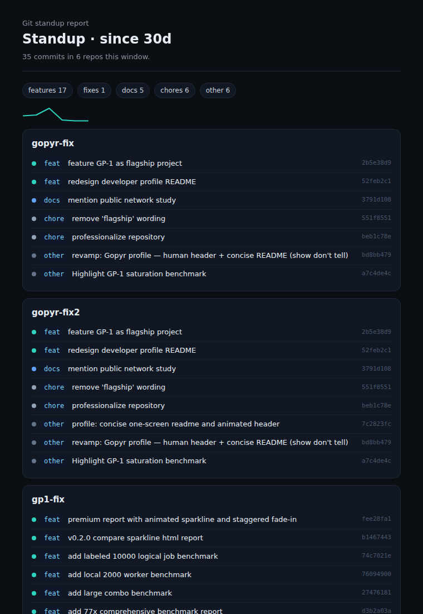

# Laporan standup dari history git lokal

Scan repo lokal kamu, ambil commit kamu sendiri dalam rentang waktu tertentu, kelompokkan berdasarkan tipe conventional commit, lalu tempel hasilnya ke Slack atau dokumen standup. Semuanya jalan lokal; tidak ada data yang keluar dari mesin.

## Kenapa

Nulis update standup tiap pagi artinya merekonstruksi apa yang kamu kerjakan kemarin, di semua repo yang kamu sentuh. Tools ini melakukannya dari git history: commit kamu, rentang waktumu, sudah dikelompokkan dan siap tempel.

## Screenshot

Output HTML dari scan nyata 30 hari di repo lokal (35 commit, 6 repo):



## Install

```bash
npm install -g .
# atau jalankan tanpa install global
node src/cli.mjs
```

## Usage

```bash
standup-report                 # 24 jam terakhir, scan direktori default
standup-report --since 48h     # rentang bebas: 24h, 7d, atau tanggal seperti 2026-08-20
standup-report --dir ~/code    # scan pohon direktori tertentu
standup-report --format slack  # terminal | slack | markdown | html
standup-report --html out.html # sama dengan --format html, tulis ke file
```

Contoh output:

```text
$ standup-report --since 24h

Standup: since yesterday (2026-08-31 09:00 -> now)
1 repo, 4 commits

gp-1  (3 commits)
  feat: compare command with delta output
  fix: remove em dashes from docs
  chore: bump version to 0.2.0

labboard  (1 commit)
  feat: auto-load real sample reports

4 commits total, 1 repo
```

## Cara kerja

1. Telusuri direktori target (default: `~/projects`, `~/code`, `~/dev`, cwd) dan cari repo git bersarang (direktori yang punya `.git`).
2. Untuk tiap repo, baca `git log --pretty` sejak awal rentang, filter ke email kamu (`git config user.email`) kecuali `--author` ditentukan.
3. Klasifikasikan prefix pesan: `feat`, `fix`, `docs`, `chore`, `refactor`, `test`, `perf`, `build`, `ci`, `revert`. Sisanya masuk `other`.
4. Kelompokkan per repo, lalu per tipe, dan render dalam format pilihanmu.

## Format

- **terminal**: daftar kelompok yang ringkas (default)
- **slack**: isi sama, teks polos ramah Slack dengan header tebal
- **markdown**: dokumen `## Standup` dengan seksi per repo
- **html**: halaman mandiri dengan bar aktivitas per hari, tanpa aset eksternal

Format HTML berguna kalau standup masuk ke wiki atau export Notion.

## Batasan

- Git lokal saja. Tidak ada integrasi GitHub/Jira/Linear (memang di luar scope).
- Pesan commit harus pakai prefix ala conventional biar pengelompokannya rapi; pesan seperti `wip` masuk `other`.
- Filter author memakai satu email. Kalau kamu commit dengan beberapa email, pakai `--author "name|email"` atau `--all`.
- Direktori non-repo dilewati diam-diam.

## Development

```bash
npm test
```

Test mencakup klasifikasi pesan dan parsing rentang waktu dengan data commit fixture yang nyata.

## License

MIT
